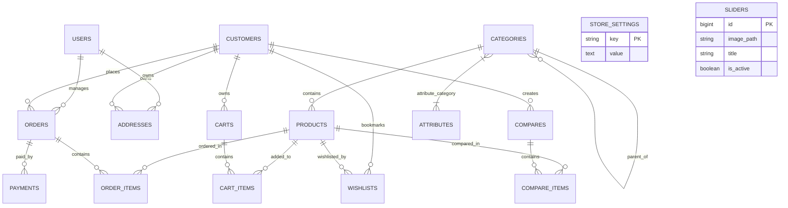

# Skynet Digital E-Commerce Platform

> **Comprehensive System Documentation & Technical Blueprint**  
> Designed for developers and AI coding agents to rapidly inspect, understand, extend, and deploy the entire application.

---

## 📑 Table of Contents

1. [Project Overview](#-project-overview)
2. [Technology Stack](#-technology-stack)
3. [System Architecture & Core Design Principles](#-system-architecture--core-design-principles)
4. [Authentication & Authorization (Dual-Guard Architecture)](#-authentication--authorization-dual-guard-architecture)
5. [Complete Database Schema & Entity Relationships](#-complete-database-schema--entity-relationships)
   - [Entity Relationship Diagram (Mermaid)](#entity-relationship-diagram-erd)
   - [Detailed Table Definitions](#detailed-table-definitions)
6. [Core Business Workflows & Controllers](#-core-business-workflows--controllers)
   - [Storefront & Catalog Browsing](#1-storefront--catalog-browsing)
   - [Cart & Variant Management](#2-cart--variant-management)
   - [Checkout, Taxes, Shipping & Payment Processing](#3-checkout-taxes-shipping--payment-processing)
   - [Payment Webhooks & Verification Lifecycle](#4-payment-webhooks--verification-lifecycle)
   - [Order Tracking & Customer Account](#5-order-tracking--customer-account)
   - [Product Comparison & Wishlist](#6-product-comparison--wishlist)
   - [Admin Backoffice & Analytics](#7-admin-backoffice--analytics)
7. [Inventory Architecture & Stock Management (Ecommerce vs. POS)](#-inventory-architecture--stock-management-ecommerce-vs-pos)
8. [Store Settings Dictionary (`store_settings`)](#-store-settings-dictionary-store_settings)
9. [Routing Map](#-routing-map)
10. [Frontend Structure & Inertia Bridge](#-frontend-structure--inertia-bridge)
11. [Environment Variables & Configuration Reference](#-environment-variables--configuration-reference)
12. [Installation & Setup Guide](#-installation--setup-guide)
13. [AI Agent Quick-Reference & Gotchas](#-ai-agent-quick-reference--gotchas)

---

## 🌟 Project Overview

**Skynet Digital E-Commerce** (`skynet-ecommerce`) is a full-stack, enterprise-grade e-commerce application built with **Laravel 12**, **Inertia.js v2**, and **Vue 3** (Composition API with `<script setup>`).

The project serves a dual purpose:
1. **Production-Ready Online Storefront:** A fast, SEO-optimized digital commerce experience with dynamic sliders, faceted product filtering, live search suggestions, multi-tier pricing, product comparisons, customer wishlists, and multi-gateway checkout (Paystack, Flutterwave, Cash on Delivery).
2. **The "Skynet Digital Skeleton" Base Template:** A structured foundation engineered for rapid rebranding and instantiation into new client e-commerce projects via a centralized, database-driven configuration system (`store_settings`).

---

## 🛠 Technology Stack

### Backend
| Component | Technology | Description |
| :--- | :--- | :--- |
| **Language** | PHP 8.2+ | Strict typing, typed properties, match expressions |
| **Framework** | Laravel 12.x | Routing, Eloquent ORM, dual auth guards, queues, events |
| **SPA Bridge** | Inertia.js Laravel 2.0 (`inertiajs/inertia-laravel`) | Single-page application protocol without building an API layer |
| **Authentication** | Dual-Guard (Eloquent) | `web` guard for Admin/Staff; `customer` guard for Shoppers |
| **OAuth / Social** | Laravel Socialite (`laravel/socialite: ^5.25`) | Google & Facebook login for customers |
| **Routing Helper** | Tightenco Ziggy (`tightenco/ziggy: ^2.5`) | Exposes Laravel named routes directly inside Vue components |
| **Image Processing** | Intervention Image 3 (`intervention/image: ^3.11`) | Image manipulation, resizing, and optimizations |
| **Security / Anti-Bot** | Cloudflare Turnstile | Captcha protection on customer and admin authentication routes |

### Frontend
| Component | Technology | Description |
| :--- | :--- | :--- |
| **Framework** | Vue 3 (`vue: ^3.x`) | Reactive Composition API utilizing `<script setup>` syntax |
| **Build Tool** | Vite 7 (`vite: ^7.0.4`) | High-speed ESM bundler and Hot Module Replacement (HMR) |
| **Styling** | Tailwind CSS v4 (`@tailwindcss/vite`, `@tailwindcss/typography`) | Modern CSS-first config with dark-mode support |
| **State Store** | Pinia (`pinia: ^3.0.3`) | Global reactive stores (e.g., Theme mode switcher in `Stores/themeStore.js`) |
| **Icons** | FontAwesome 6/7 Vue Component | Scalable SVG icon library registered globally (`<font-awesome-icon>`) |
| **Animations** | AOS (`aos: ^3.0.0-beta.6`) | Animate On Scroll micro-interactions (dynamically imported) |
| **Rich Text Editor** | Vue Quill (`@vueup/vue-quill: ^1.2.0`) | WYSIWYG editor for admin product descriptions |
| **PDF Generation** | HTML2PDF (`html2pdf.js: ^0.14.0`) | Client-side HTML to PDF invoice download and printing |
| **Notifications** | Vue-Toastification (`vue-toastification: ^2.0.0-rc.5`) | Toast alerts for actions and validation messages |

---

## 🏗 System Architecture & Core Design Principles

1. **Inertia.js Single-Page Application (SDR):**  
   The application does not use a traditional decoupled REST/GraphQL API. Backend controllers return `Inertia::render('ViewName', [props])`. Routing is handled server-side via `routes/web.php` and consumed client-side using `<Link>` components and Ziggy's `route()` helper.

2. **Global Shared State via `HandleInertiaRequests`:**  
   Every Inertia response automatically carries:
   - `auth.user` (Staff/Admin user object)
   - `auth.customer` (Authenticated customer object)
   - `auth.type` (`'staff'`, `'customer'`, or `null`)
   - `cart_count` (Real-time count of items in the current user's or session's cart)
   - `compare_count` (Count of items in comparison list)
   - `store_settings` (Full array of all settings loaded from the `store_settings` table)
   - `categories` (Recursive nested category tree with subcategories where `visible_in_menu = true`)
   - `flash` (`success`, `error`, `message` flash session values)
   - `turnstileSiteKey` (Cloudflare Turnstile site key for forms)

3. **Centralized Settings-First Architecture (`StoreSetting`):**  
   Virtually every global store parameter—company details, payment gateway toggles, tax rates, shipping waybill costs, free shipping thresholds, hero slides, and feature switches—is retrieved dynamically from the `store_settings` table via `StoreSetting::allAsArray()` or `StoreSetting::get($key, $default)`.

4. **Guest & Authenticated Experience Parity:**  
   Guests can add items to carts, browse comparisons, initiate checkout, and track orders via public unique tracking numbers (`SKY-XXXXXXXX`). When authenticated as a customer, their carts and comparisons transition to customer records, unlocking order history and persistent wishlists.

---

## 🔐 Authentication & Authorization (Dual-Guard Architecture)

The system enforces a clean separation between administrative personnel and store shoppers via two separate guards defined in `config/auth.php`:

```
                           ┌────────────────────────┐
                           │   Incoming Request     │
                           └───────────┬────────────┘
                                       │
                ┌──────────────────────┴──────────────────────┐
                ▼                                             ▼
     [Admin / Staff Portal]                        [Shopper / Storefront]
        Prefix: `/admin`                               Root Domain `/`
      Guard: `web` (Session)                       Guard: `customer` (Session)
      Model: `App\Models\User`                     Model: `App\Models\Customer`
      Table: `users`                               Table: `customers`
      Middleware: `auth:web`, `admin`              Middleware: `auth:customer`
      Roles: Administrator, Staff, Super Admin     Auth: Email/Pass + Socialite (Google/FB)
```

### 1. `web` Guard (Staff / Admin)
- **Model:** `App\Models\User`
- **Table:** `users`
- **Roles (`App\Enums\RoleEnums`):**
  - `administrator`
  - `super administrator`
  - `staff`
  - `user`
- **Status (`App\Enums\StatusEnums`):** `enable`, `disable`. Disabled users are automatically logged out and blocked during login attempts.
- **Middleware:** `AdminMiddleware` ensures only users with `role` matching `administrator` or `super administrator` can access `/admin/*` routes (other than `/admin/login`).

### 2. `customer` Guard (Storefront Customers)
- **Model:** `App\Models\Customer`
- **Table:** `customers`
- **Features:**
  - Standard registration and login with bcrypt hashing.
  - Socialite OAuth login (`/auth/{provider}/redirect` and `/auth/{provider}/callback`) for `google` and `facebook`.
  - Links customer records to orders, wishlists, address books, and persistent shopping carts.

---

## 🗄 Complete Database Schema & Entity Relationships

### Entity Relationship Diagram (ERD)



---

### Detailed Table Definitions

#### 1. `users` (Staff & Administrators)
Primary identity table for the admin backoffice.
```sql
CREATE TABLE users (
    id BIGINT UNSIGNED AUTO_INCREMENT PRIMARY KEY,
    name VARCHAR(255) NOT NULL,
    email VARCHAR(255) NOT NULL UNIQUE,
    email_verified_at TIMESTAMP NULL,
    password VARCHAR(255) NOT NULL,
    phone VARCHAR(255) NULL,
    address TEXT NULL,
    role ENUM('user', 'staff', 'administrator', 'super administrator') DEFAULT 'administrator',
    status ENUM('enable', 'disable') DEFAULT 'enable',
    remember_token VARCHAR(100) NULL,
    created_at TIMESTAMP NULL,
    updated_at TIMESTAMP NULL
);
```

#### 2. `customers` (Storefront Shoppers)
Dedicated identity table for customers with OAuth integration.
```sql
CREATE TABLE customers (
    id BIGINT UNSIGNED AUTO_INCREMENT PRIMARY KEY,
    name VARCHAR(255) NOT NULL,
    email VARCHAR(255) NOT NULL UNIQUE,
    email_verified_at TIMESTAMP NULL,
    password VARCHAR(255) NULL,           -- NULL if created solely via social OAuth
    provider_name VARCHAR(255) NULL,      -- 'google', 'facebook', or NULL
    provider_id VARCHAR(255) NULL,        -- Remote OAuth user ID
    provider_token TEXT NULL,             -- Access token from OAuth provider
    phone VARCHAR(255) NULL,
    remember_token VARCHAR(100) NULL,
    created_at TIMESTAMP NULL,
    updated_at TIMESTAMP NULL
);
```

#### 3. `categories` (Hierarchical Category Tree)
Supports self-referential nesting (subcategories) and storefront menu ordering.
```sql
CREATE TABLE categories (
    id BIGINT UNSIGNED AUTO_INCREMENT PRIMARY KEY,
    parent_id BIGINT UNSIGNED NULL,
    name VARCHAR(255) NOT NULL,
    slug VARCHAR(255) NOT NULL UNIQUE,
    description TEXT NULL,
    image VARCHAR(255) NULL,
    visible_in_menu BOOLEAN NOT NULL DEFAULT TRUE,
    menu_position SMALLINT UNSIGNED NOT NULL DEFAULT 0,
    created_at TIMESTAMP NULL,
    updated_at TIMESTAMP NULL,
    FOREIGN KEY (parent_id) REFERENCES categories(id) ON DELETE SET NULL
);
```

#### 4. `products` (Catalog Core)
Comprehensive product entity supporting inventory, time-limited promotional pricing, JSON variants, dynamic attributes, and related cross-selling.
```sql
CREATE TABLE products (
    id BIGINT UNSIGNED AUTO_INCREMENT PRIMARY KEY,
    category_id BIGINT UNSIGNED NOT NULL,
    name VARCHAR(255) NOT NULL,
    slug VARCHAR(255) NOT NULL UNIQUE,
    url_key VARCHAR(255) NOT NULL UNIQUE,                -- SEO URL identifier used in routes (/product/{url_key})
    product_number VARCHAR(100) NULL UNIQUE,             -- Internal inventory code (e.g. PRD-0001)
    sku VARCHAR(100) NULL UNIQUE,                        -- Stock Keeping Unit
    short_description TEXT NULL,
    description LONGTEXT NULL,
    price DECIMAL(10, 2) NOT NULL,                       -- Base regular selling price
    cost_price DECIMAL(10, 2) NULL,                      -- Internal unit cost (for profit calculations)
    discount_price DECIMAL(10, 2) NULL,                  -- Fixed promotional discounted price
    special_price DECIMAL(10, 2) NULL,                   -- Promotional price active within a date range
    special_price_from TIMESTAMP NULL,                   -- Promotion start timestamp
    special_price_to TIMESTAMP NULL,                     -- Promotion end timestamp
    stock INT NOT NULL DEFAULT 0,                        -- Available inventory count
    image VARCHAR(255) NULL,                             -- Primary featured thumbnail image
    images JSON NULL,                                    -- Array of additional image paths: ["products/abc.jpg", ...]
    variants JSON NULL,                                  -- Array of variants: [{"name": "128GB", "price": "50000"}, ...]
    attributes JSON NULL,                                -- Key-value map of assigned attributes: {"1": "Blue", "2": "Large"}
    related_products JSON NULL,                          -- Array of product IDs for cross-selling: [2, 5, 8]
    status BOOLEAN NOT NULL DEFAULT TRUE,                -- Active (1) or Inactive (0)
    is_new BOOLEAN NOT NULL DEFAULT FALSE,               -- Tagged as new arrival
    is_featured BOOLEAN NOT NULL DEFAULT FALSE,          -- Highlighted in featured carousels
    visible_individually BOOLEAN NOT NULL DEFAULT TRUE,  -- Whether visible in public catalog search
    show_stock_level BOOLEAN NOT NULL DEFAULT TRUE,      -- Whether to display exact stock on storefront
    created_at TIMESTAMP NULL,
    updated_at TIMESTAMP NULL,
    FOREIGN KEY (category_id) REFERENCES categories(id) ON DELETE CASCADE
);
```

#### 5. `attributes` (Dynamic Specification Filters)
Global specifications (e.g., Color, RAM, Screen Size) available for faceted filtering.
```sql
CREATE TABLE attributes (
    id BIGINT UNSIGNED AUTO_INCREMENT PRIMARY KEY,
    name VARCHAR(255) NOT NULL,                          -- E.g., "Color", "Storage", "Size"
    type VARCHAR(255) NOT NULL DEFAULT 'select',         -- 'select', 'color', 'range', 'text'
    options JSON NULL,                                   -- Available options: ["64GB", "128GB", "256GB"]
    created_at TIMESTAMP NULL,
    updated_at TIMESTAMP NULL
);
```

#### 6. `attribute_category` (Pivot Table)
Defines which filterable attributes are relevant to each category.
```sql
CREATE TABLE attribute_category (
    attribute_id BIGINT UNSIGNED NOT NULL,
    category_id BIGINT UNSIGNED NOT NULL,
    PRIMARY KEY (attribute_id, category_id),
    FOREIGN KEY (attribute_id) REFERENCES attributes(id) ON DELETE CASCADE,
    FOREIGN KEY (category_id) REFERENCES categories(id) ON DELETE CASCADE
);
```

#### 7. `carts` (Cart Headers)
Supports both anonymous guests (via `session_id`) and logged-in customers (via `customer_id`).
```sql
CREATE TABLE carts (
    id BIGINT UNSIGNED AUTO_INCREMENT PRIMARY KEY,
    customer_id BIGINT UNSIGNED NULL,
    session_id VARCHAR(255) NULL,
    created_at TIMESTAMP NULL,
    updated_at TIMESTAMP NULL,
    FOREIGN KEY (customer_id) REFERENCES customers(id) ON DELETE SET NULL,
    INDEX (session_id)
);
```

#### 8. `cart_items` (Cart Line Items)
Line items within an active shopping cart with variant specifications.
```sql
CREATE TABLE cart_items (
    id BIGINT UNSIGNED AUTO_INCREMENT PRIMARY KEY,
    cart_id BIGINT UNSIGNED NOT NULL,
    product_id BIGINT UNSIGNED NOT NULL,
    quantity INT NOT NULL,
    price DECIMAL(10, 2) NOT NULL,                       -- Unit price at time of adding (or variant price)
    variant VARCHAR(255) NULL,                           -- Selected variant string (e.g. "256GB SSD")
    created_at TIMESTAMP NULL,
    updated_at TIMESTAMP NULL,
    FOREIGN KEY (cart_id) REFERENCES carts(id) ON DELETE CASCADE,
    FOREIGN KEY (product_id) REFERENCES products(id) ON DELETE CASCADE
);
```

#### 9. `orders` (Order Headers)
Full snapshot of customer order, shipping method, financial totals, and generated tracking number.
```sql
CREATE TABLE orders (
    id BIGINT UNSIGNED AUTO_INCREMENT PRIMARY KEY,
    tracking_number VARCHAR(255) NULL UNIQUE,            -- Format: 'SKY-XXXXXXXX' (auto-generated in model)
    customer_id BIGINT UNSIGNED NULL,
    guest_email VARCHAR(255) NULL,                       -- Stored when guest checks out without an account
    total_amount DECIMAL(12, 2) NOT NULL,                -- Subtotal + Tax + Service Fee + Shipping
    status VARCHAR(255) NOT NULL DEFAULT 'pending',      -- 'pending', 'processing', 'completed', 'cancelled'
    payment_method VARCHAR(255) NULL,                    -- 'paystack', 'flutterwave', 'cod'
    payment_reference VARCHAR(255) NULL,                 -- Transaction reference / tx_ref from gateway
    billing_name VARCHAR(255) NULL,
    billing_email VARCHAR(255) NULL,
    billing_phone VARCHAR(255) NULL,
    billing_address VARCHAR(255) NULL,
    delivery_method VARCHAR(255) NULL DEFAULT 'delivery',-- 'delivery' or 'pickup'
    created_at TIMESTAMP NULL,
    updated_at TIMESTAMP NULL,
    FOREIGN KEY (customer_id) REFERENCES customers(id) ON DELETE SET NULL
);
```

#### 10. `order_items` (Order Line Items)
Preserves pricing and quantity historical record for each item in an order.
```sql
CREATE TABLE order_items (
    id BIGINT UNSIGNED AUTO_INCREMENT PRIMARY KEY,
    order_id BIGINT UNSIGNED NOT NULL,
    product_id BIGINT UNSIGNED NULL,
    quantity INT NOT NULL,
    price DECIMAL(10, 2) NOT NULL,
    variant VARCHAR(255) NULL,
    created_at TIMESTAMP NULL,
    updated_at TIMESTAMP NULL,
    FOREIGN KEY (order_id) REFERENCES orders(id) ON DELETE CASCADE,
    FOREIGN KEY (product_id) REFERENCES products(id) ON DELETE SET NULL
);
```

#### 11. `payments` (Payment Transaction Audit Log)
Logs payment gateway responses, references, amounts, and statuses.
```sql
CREATE TABLE payments (
    id BIGINT UNSIGNED AUTO_INCREMENT PRIMARY KEY,
    order_id BIGINT UNSIGNED NOT NULL,
    provider VARCHAR(255) NOT NULL,                      -- 'paystack', 'flutterwave', etc.
    reference VARCHAR(255) NOT NULL UNIQUE,
    amount DECIMAL(12, 2) NOT NULL,
    status VARCHAR(255) NOT NULL DEFAULT 'pending',
    response JSON NULL,                                  -- Full gateway JSON response payload
    created_at TIMESTAMP NULL,
    updated_at TIMESTAMP NULL,
    FOREIGN KEY (order_id) REFERENCES orders(id) ON DELETE CASCADE
);
```

#### 12. `addresses` (Customer Address Book)
Saved shipping and billing destinations for registered customers.
```sql
CREATE TABLE addresses (
    id BIGINT UNSIGNED AUTO_INCREMENT PRIMARY KEY,
    customer_id BIGINT UNSIGNED NULL,
    name VARCHAR(255) NOT NULL,
    email VARCHAR(255) NULL,
    phone VARCHAR(255) NULL,
    address TEXT NOT NULL,
    city VARCHAR(255) NOT NULL,
    state VARCHAR(255) NOT NULL,
    country VARCHAR(255) NOT NULL,
    created_at TIMESTAMP NULL,
    updated_at TIMESTAMP NULL,
    FOREIGN KEY (customer_id) REFERENCES customers(id) ON DELETE CASCADE
);
```

#### 13. `wishlists` (Customer Wishlists)
Bookmarks kept by authenticated customers.
```sql
CREATE TABLE wishlists (
    id BIGINT UNSIGNED AUTO_INCREMENT PRIMARY KEY,
    customer_id BIGINT UNSIGNED NOT NULL,
    product_id BIGINT UNSIGNED NOT NULL,
    created_at TIMESTAMP NULL,
    updated_at TIMESTAMP NULL,
    UNIQUE (customer_id, product_id),
    FOREIGN KEY (customer_id) REFERENCES customers(id) ON DELETE CASCADE,
    FOREIGN KEY (product_id) REFERENCES products(id) ON DELETE CASCADE
);
```

#### 14. `compares` & `compare_items` (Product Comparisons)
Allows guests (via `session_id`) or customers to compare up to 4 products side-by-side.
```sql
CREATE TABLE compares (
    id BIGINT UNSIGNED AUTO_INCREMENT PRIMARY KEY,
    session_id VARCHAR(255) NULL,
    customer_id BIGINT UNSIGNED NULL,
    created_at TIMESTAMP NULL,
    updated_at TIMESTAMP NULL,
    FOREIGN KEY (customer_id) REFERENCES customers(id) ON DELETE CASCADE
);

CREATE TABLE compare_items (
    id BIGINT UNSIGNED AUTO_INCREMENT PRIMARY KEY,
    compare_id BIGINT UNSIGNED NOT NULL,
    product_id BIGINT UNSIGNED NOT NULL,
    created_at TIMESTAMP NULL,
    updated_at TIMESTAMP NULL,
    FOREIGN KEY (compare_id) REFERENCES compares(id) ON DELETE CASCADE,
    FOREIGN KEY (product_id) REFERENCES products(id) ON DELETE CASCADE
);
```

#### 15. `sliders` (Hero Carousel Slides)
Managed in the admin dashboard for homepage promotions.
```sql
CREATE TABLE sliders (
    id BIGINT UNSIGNED AUTO_INCREMENT PRIMARY KEY,
    image_path VARCHAR(255) NOT NULL,
    title VARCHAR(255) NULL,
    subtitle VARCHAR(255) NULL,
    button_text VARCHAR(255) NULL,
    button_link VARCHAR(255) NULL,
    order INT NOT NULL DEFAULT 0,
    is_active BOOLEAN NOT NULL DEFAULT TRUE,
    created_at TIMESTAMP NULL,
    updated_at TIMESTAMP NULL
);
```

#### 16. `store_settings` (Dynamic Configuration Key-Value Store)
Centralized configuration registry controlling branding, payment gateways, fees, shipping, and features.
```sql
CREATE TABLE store_settings (
    id BIGINT UNSIGNED AUTO_INCREMENT PRIMARY KEY,
    key VARCHAR(255) NOT NULL UNIQUE,
    value TEXT NULL,
    created_at TIMESTAMP NULL,
    updated_at TIMESTAMP NULL
);
```

#### 17. Framework & Operational Tables
- `sessions`: Session persistence for both `web` and `customer` guards (`id`, `user_id`, `ip_address`, `user_agent`, `payload`, `last_activity`).
- `password_reset_tokens`: For customer and user password recovery (`email`, `token`, `created_at`).
- `cache` & `cache_locks`: Database cache driver tables.
- `jobs` & `job_batches` & `failed_jobs`: Asynchronous queue management.

---

## ⚡ Core Business Workflows & Controllers

### 1. Storefront & Catalog Browsing
- **Controller:** `App\Http\Controllers\Frontend\HomeController` and `App\Http\Controllers\Frontend\ProductController`
- **Homepage (`/`):** Loads active carousel sliders (if `home_slider_enabled = 1`), 4 random featured products, 4 latest new arrivals, and up to 8 top-level root categories.
- **Catalog Filter (`/shop`):**
  - **Category Query:** Filter by parent category slug (matches products in the parent *or* any child category) or directly by subcategory slug.
  - **Faceted Attributes:** Query parameter `attrs[<attribute_id>]=<value>` performs JSON filtering via `whereJsonContains("attributes->{$attrId}", $value)`.
  - **Search:** Matches product name.
  - **Live Search Dropdown (`/search/suggestions`):** Lightweight JSON endpoint returning top 5 matching products (`name`, `price`, `discount_price`, `image`, `url_key`, `category`) when query length $\ge 2$.
- **Single Product View (`/product/{url_key}`):**
  - Resolves via `url_key` (fallback to `slug`).
  - Calculates dynamic effective price using `getEffectivePriceAttribute()` (respecting `special_price` window if active).
  - Fetches related products from explicit manual assignments (`related_products` JSON) with automatic fallback to products sharing the same category.

### 2. Cart & Variant Management
- **Controller:** `App\Http\Controllers\Frontend\CartController`
- **Session / Customer Resolution:** If customer is logged in, queries by `customer_id`. Otherwise, queries by `request->session()->getId()`.
- **Variant Pricing:** When adding a product with a selected variant, the controller parses the product's `variants` JSON array. If the variant specifies an explicit price override, that unit price is applied to the cart line item.
- **Header Badge:** Shared via `HandleInertiaRequests::getCartCount()`, summing the total item quantity in real time across page loads.

### 3. Checkout, Taxes, Shipping & Payment Processing
- **Controller:** `App\Http\Controllers\Frontend\CheckoutController`
- **Checkout Calculations:**
  $$\text{Subtotal} = \sum (\text{item.price} \times \text{item.quantity})$$
  $$\text{Tax} = \begin{cases} \frac{\text{Subtotal} \times \text{tax\_rate}}{100} & \text{if tax\_enabled} = 1 \\ 0 & \text{otherwise} \end{cases}$$
  $$\text{Service Fee} = \begin{cases} \text{service\_fee\_amount} & \text{if service\_fee\_enabled} = 1 \\ 0 & \text{otherwise} \end{cases}$$
  $$\text{Shipping Fee} = \begin{cases} 0 & \text{if delivery\_method} = \text{'pickup'} \\ 0 & \text{if Subtotal} \ge \text{free\_shipping\_threshold} \\ \text{waybill\_fee} & \text{if shipping\_enabled} = 1 \\ 0 & \text{otherwise} \end{cases}$$
  $$\text{Total Amount} = \text{Subtotal} + \text{Tax} + \text{Service Fee} + \text{Shipping Fee}$$
- **Order Creation & Tracking Number:**
  - When the order is persisted, an Eloquent `creating` hook on `App\Models\Order` auto-generates an 8-character unique alphanumeric uppercase code prefixed by `SKY-` (e.g. `SKY-A7K92M4X`).
- **Gateway Dispatch:**
  - **Cash on Delivery (`cod`):** Redirects immediately to `/checkout/success/{tracking}` with `status = 'pending'`.
  - **Paystack (`paystack`):** Initializes payment via `PaystackService`, updates order `payment_reference` with Paystack reference, and uses `Inertia::location()` to redirect the browser to the Paystack authorization checkout URL.
  - **Flutterwave (`flutterwave`):** Initializes payment via `FlutterwaveService`, saves `tx_ref`, and uses `Inertia::location()` to redirect the browser to Flutterwave's hosted payment gateway link.

### 4. Payment Webhooks & Verification Lifecycle

```
Shopper Browser           Paystack / Flutterwave Gateways              Laravel Backend
     │                                   │                                    │
     │ 1. Place Order                    │                                    │
     ├───────────────────────────────────────────────────────────────────────►│
     │                                   │                                    │ 2. Create Order (status: pending)
     │                                   │                                    │    Generate 'SKY-XXXXXXXX'
     │ 3. Redirect to Hosted Gateway     │                                    │
     │◄───────────────────────────────────────────────────────────────────────┤
     │                                   │                                    │
     │ 4. Complete Payment Card / USSD   │                                    │
     ├──────────────────────────────────►│                                    │
     │                                   │ 5. POST Webhook (`charge.success`) │
     │                                   ├───────────────────────────────────►│
     │                                   │   (x-paystack-signature validation)│ 6. Verify Signature & Amount
     │                                   │                                    │    Update Order status: 'processing'
     │ 7. Redirect to Callback URL       │                                    │
     ├───────────────────────────────────────────────────────────────────────►│ 8. Redirect to Success Page
```

- **Paystack Webhook (`/webhook/paystack`):**  
  Validates `x-paystack-signature` header against `hash_hmac('sha512', payload, PAYSTACK_SECRET_KEY)`. If event is `charge.success` and paid amount matches order total ($\times 100$ in kobo), sets order status to `processing`.
- **Flutterwave Webhook (`/webhook/flutterwave`):**  
  Validates `verif-hash` request header against configured secret hash. If event is `charge.completed` and amount matches, sets order status to `processing`.
- **CSRF Token Exception:**  
  Configured in `bootstrap/app.php` via `$middleware->validateCsrfTokens(except: ['flw-webhook', 'webhook/paystack', 'webhook/flutterwave'])`.

### 5. Order Tracking & Customer Account
- **Controller:** `App\Http\Controllers\Frontend\OrderTrackingController`
- **Public Tracking (`/track-order` and `/track/{tracking}`):**  
  Accessible to any guest or customer without logging in. Searches by tracking number (`SKY-XXXXXXXX`) or order ID. Optional email verification for guest privacy.
- **Customer Order Dashboard (`/my-orders`):**  
  Protected by `auth:customer` middleware. Displays paginated history of all orders belonging to the customer with direct drill-down to `/my-orders/{order}`.

### 6. Product Comparison & Wishlist
- **Product Comparison (`/compare`):**  
  Guests or customers can add up to 4 products to their comparison table. Eager-loads product specifications and category attributes side-by-side.
- **Wishlist (`/wishlist`):**  
  Customer-only (`auth:customer`). Single-click toggle (`/wishlist/toggle`) to add or remove products from their personal saved collection. Controlled by the `wishlist_enabled` setting.

### 7. Admin Backoffice & Analytics
- **Dashboard (`/admin/dashboard`):**  
  Summary KPIs: Total Orders, Total Revenue (sum of completed orders), Total Products, Total Registered Users, and recent 5 orders.
- **Products (`/admin/products`):**  
  Multi-image file upload, variant builder (name & price), dynamic attribute values, related product search and assignment, inventory stock status.
- **Categories (`/admin/categories`):**  
  Parent/child hierarchy, menu position integer, menu visibility toggle, and category-level attribute association.
- **Orders (`/admin/orders`):**  
  Full order management with status workflow transitions: `pending` $\rightarrow$ `paid` $\rightarrow$ `shipped` $\rightarrow$ `completed` (or `cancelled`).
- **Printable Invoices (`/admin/orders/{order}/invoice`):**  
  Inertia invoice view using `html2pdf.js` for instant one-click PDF generation and downloading.
- **Revenue Analytics (`/admin/revenue`):**  
  Date-range filtered financial overview, calculating total revenue, average order value, daily earnings timeline, and breakdown by payment gateway method (`paystack`, `flutterwave`, `cod`).
- **Store Configuration Hub (`/admin/settings`):**  
  Real-time editing of store branding, hero titles/subtitles, contact details, payment credentials, taxes, fees, shipping thresholds, and feature flags.

---

## 📦 Inventory Architecture & Stock Management (Ecommerce vs. POS)

The platform operates a specialized dual-inventory model that cleanly isolates physical retail items from online warehouse goods:

### 1. Dual Inventory Source Model

| Attribute | Connected POS Item (`inventory_source = 'pos'`) | Ecommerce Only Item (`inventory_source = 'ecommerce'`) |
| :--- | :--- | :--- |
| **Physical Ownership** | Physical store branch managed via **Skynet POS**. | Online warehouse / web-exclusive catalog. |
| **Stock & Price Control** | Automatically synced from POS (`SyncedPosItem`). In-app price and stock fields are locked. | 100% manual administrative control over price and stock counts. |
| **Online Order Impact** | Online checkout creates an authoritative reservation on the physical POS server (`PosReservationService`). | Deducts directly from local `products.stock` in the website database. |
| **POS Deletion Protection** | Registered with POS API deletion protection. | Unregistered and independent. |

### 2. Core Operational Rules & Architectural Decisions

1. **Adjustments & Purchasing Restricted to "Ecommerce Only" Products:**  
   Manual stock quantity adjustments (damage, spoilage, audit recounts) and supplier purchase receiving must **strictly target Ecommerce Only items**. Physical POS goods must be received and adjusted directly on the physical POS machine so cash drawers, barcodes, and till receipts balance out; any web-based stock edits on POS items would be overwritten by subsequent POS sync cycles.
2. **Dedicated Immutable Inventory Ledger (`inventory_logs`):**  
   Tracks every stock increase or decrease across the website:
   - **Sales (`sale`):** Customer order checkouts referencing order tracking number.
   - **Returns / Cancellations (`cancellation`):** Order cancellation restoring inventory.
   - **Adjustments (`adjustment`):** Codified reasons (physical recount, damaged goods, expired, theft/loss, internal marketing samples).
   - **Purchases (`purchase`):** Supplier deliveries and warehouse restocking referencing PO number.
3. **Isolation of POS Sync Checks from Inventory Logs:**  
   Routine background POS availability queries remain in `pos_sync_logs` rather than flooding `inventory_logs`. This keeps the main inventory ledger focused purely on authentic business transactions, sales, adjustments, and purchases.
4. **Cost Price Accounting on Purchase:**  
   When receiving supplier stock, unit purchase cost automatically updates the product's `cost_price` to the **latest purchase price** to maintain accurate gross profit reporting.

### 3. Catalog CSV Export & Import Specifications

- **Export (`/admin/products/export`):**
  - Columns: `ID`, `Name`, `SKU`, `Inventory Source`, `POS Item ID`, `Synced POS Item Name`, `Category`, `Brand`, `Price (NGN)`, `Cost Price (NGN)`, `Special Price (NGN)`, `Stock`, `Status`, `Is Featured`, `Variants Count`, `Variant Details`, `Created At`, `URL Key`, `Thumbnail`.
  - **`URL Key`** and **`Thumbnail`** are positioned as the **final two columns**.
  - When available, `Thumbnail` outputs the full public web URL (e.g. `https://yourdomain.com/storage/products/image.webp`).
- **Import (`/admin/products/import`):**
  - **Header Name-Based Mapping:** Columns are resolved dynamically by normalized header names (`Thumbnail`, `Image`, `URL Key`, `SKU`, etc.), making column order completely independent.
  - **Path Normalization:** Automatically strips domain/storage prefixes (e.g., `https://.../storage/products/...` $\rightarrow$ `products/...`).
  - **Remote Asset Ingestion:** When an external HTTP/HTTPS image URL from a supplier is provided, the importer automatically downloads and saves the image to `storage/app/public/products/` so it is permanently hosted locally.

---

## ⚙ Store Settings Dictionary (`store_settings`)

All runtime behavior is controlled through the key-value repository stored in the `store_settings` table:

| Setting Key | Type | Default Value | Description / Impact |
| :--- | :--- | :--- | :--- |
| **`company_name`** | string | `'Skynet Digital Store'` | Store brand title displayed in header, footer, and invoices |
| **`company_tagline`** | string | `'Your One-Stop Shop for Premium Tech & Gear'` | Header / hero brand slogan |
| **`company_email`** | string | `'support@skynetdigitalhub.com.ng'` | Primary customer service and notification email |
| **`company_phone`** | string | `'+2348032072831'` | Support telephone and WhatsApp contact line |
| **`company_address`** | string | `'Delta State, Nigeria'` | Physical address shown in footer and invoices |
| **`company_logo`** | file path | `null` | Stored in `storage/app/public/settings/` |
| **`home_slider_enabled`** | boolean ('1'/'0') | `'1'` | If `'1'`, renders the dynamic database slider carousel |
| **`home_marquee_enabled`**| boolean ('1'/'0') | `'0'` | Controls top notification banner marquee |
| **`home_marquee_text`**   | string | `''` | Notification ticker message |
| **`hero_enabled`** | boolean ('1'/'0') | `'1'` | Enables static hero banner block |
| **`hero_badge`** | string | `'New Collection 2026'` | Pill badge text above the hero headline |
| **`hero_title`** | string | `'Discover Digital'` | Main hero headline prefix |
| **`hero_title_highlight`**| string | `'Excellence'` | Gradient-highlighted hero keyword |
| **`hero_subtitle`** | string | `'Shop premium products...'`| Hero paragraph description |
| **`hero_cta_primary`** | string | `'Shop Now'` | Primary button label |
| **`hero_cta_secondary`** | string | `'Explore Categories'` | Secondary button label |
| **`hero_image`** | file path | `null` | Hero banner graphic |
| **`feature_1_title`** / **`feature_1_desc`** | string | `'Secure Payments'` | Homepage feature card 1 |
| **`feature_2_title`** / **`feature_2_desc`** | string | `'Fast Checkout'` | Homepage feature card 2 |
| **`feature_3_title`** / **`feature_3_desc`** | string | `'Premium Support'` | Homepage feature card 3 |
| **`paystack_enabled`** | boolean ('1'/'0') | `'1'` | Toggles Paystack gateway visibility at checkout |
| **`flutterwave_enabled`**| boolean ('1'/'0') | `'1'` | Toggles Flutterwave gateway visibility at checkout |
| **`cod_enabled`** | boolean ('1'/'0') | `'1'` | Toggles Cash on Delivery option at checkout |
| **`tax_enabled`** | boolean ('1'/'0') | `'1'` | If `'1'`, calculates VAT/tax on checkout subtotal |
| **`tax_rate`** | numeric | `'7.5'` | Tax percentage rate (e.g. 7.5%) |
| **`service_fee_enabled`** | boolean ('1'/'0') | `'0'` | If `'1'`, adds flat processing fee |
| **`service_fee_amount`** | numeric | `'0'` | Flat processing fee amount |
| **`shipping_enabled`** | boolean ('1'/'0') | `'1'` | Enables delivery shipping calculations |
| **`waybill_fee`** | numeric | `'1500'` | Standard delivery fee charged per order |
| **`pickup_enabled`** | boolean ('1'/'0') | `'1'` | Allows customer in-store pickup ($0 shipping fee) |
| **`pickup_address`** | string | `'123 Digital Hub Street...'`| Physical warehouse address for order collection |
| **`free_shipping_threshold`** | numeric | `'50000'` | Free shipping awarded when subtotal reaches this value |
| **`shop_enabled`** | boolean ('1'/'0') | `'1'` | Master catalog browsing toggle |
| **`customer_registration_enabled`** | boolean ('1'/'0') | `'1'` | Allows new shopper self-registration |
| **`guest_checkout_enabled`** | boolean ('1'/'0') | `'1'` | Allows checkout without creating an account |
| **`order_tracking_enabled`** | boolean ('1'/'0') | `'1'` | Toggles public tracking form accessibility |
| **`wishlist_enabled`** | boolean ('1'/'0') | `'0'` | Toggles customer wishlist features storewide |
| **`reviews_enabled`** | boolean ('1'/'0') | `'0'` | Product review module switch |
| **`tracking_number_prefix`** | string | `'SKY-'` | Prefix used when generating tracking codes |
| **`show_stock_level_default`** | boolean ('1'/'0') | `'1'` | Default visibility of stock numbers on products |
| **`google_auth_enabled`** | boolean ('1'/'0') | `'0'` | Enables Google Socialite OAuth button |
| **`facebook_auth_enabled`**| boolean ('1'/'0') | `'0'` | Enables Facebook Socialite OAuth button |

---

## 🗺 Routing Map

### Public Storefront Routes
| Method | URI | Controller Action | Name | Description |
| :--- | :--- | :--- | :--- | :--- |
| `GET` | `/` | `Frontend\HomeController@index` | `home` | Store homepage with hero & products |
| `GET` | `/shop` | `Frontend\ProductController@index` | `shop.index` | Product catalog with filters |
| `GET` | `/product/{url_key}` | `Frontend\ProductController@show` | `shop.show` | Single product detail page |
| `GET` | `/search/suggestions` | Closure (`routes/web.php`) | `search.suggestions` | Live search JSON auto-complete |
| `GET` | `/cart` | `Frontend\CartController@index` | `cart.index` | Shopping cart view |
| `POST`| `/cart` | `Frontend\CartController@store` | `cart.store` | Add item to cart |
| `PUT` | `/cart/{cartItem}` | `Frontend\CartController@update` | `cart.update` | Update item quantity |
| `DELETE`| `/cart/{cartItem}` | `Frontend\CartController@destroy` | `cart.destroy` | Remove item from cart |
| `GET` | `/compare` | `Frontend\CompareController@index` | `compare.index` | Product comparison table |
| `POST`| `/compare` | `Frontend\CompareController@store` | `compare.store` | Add product to compare |
| `DELETE`| `/compare/{compareItem}`| `Frontend\CompareController@destroy` | `compare.destroy`| Remove from compare |
| `GET` | `/checkout` | `Frontend\CheckoutController@index` | `checkout.index` | Checkout details page |
| `POST`| `/checkout/process` | `Frontend\CheckoutController@process` | `checkout.process` | Process order & initialize payment |
| `GET` | `/checkout/success/{tracking}`| `Frontend\CheckoutController@success` | `checkout.success` | Order confirmation screen |
| `GET` | `/payment/callback` | `Frontend\CheckoutController@callback` | `payment.callback` | Gateway return callback handler |
| `POST`| `/webhook/paystack` | `Frontend\CheckoutController@paystackWebhook` | `webhook.paystack` | Paystack payment verification hook |
| `POST`| `/webhook/flutterwave`| `Frontend\CheckoutController@flutterwaveWebhook`| `webhook.flutterwave`| Flutterwave verification hook |
| `GET` | `/track-order` | `Frontend\OrderTrackingController@index` | `order.track` | Public tracking lookup form |
| `POST`| `/track-order` | `Frontend\OrderTrackingController@track` | `order.track.search` | Process order lookup |
| `GET` | `/track/{tracking}` | `Frontend\OrderTrackingController@trackDirect`| `order.track.direct`| Direct shareable tracking link |

### Customer Authentication & Profile Routes (`guard: customer`)
| Method | URI | Controller Action | Name | Auth Required |
| :--- | :--- | :--- | :--- | :--- |
| `GET` | `/login` | `Frontend\CustomerAuthController@showLogin` | `login` | Guest only |
| `POST`| `/login` | `Frontend\CustomerAuthController@login` | `customer.login.submit` | Guest only (Turnstile protected) |
| `GET` | `/register` | `Frontend\CustomerAuthController@showRegister` | `register` | Guest only |
| `POST`| `/register` | `Frontend\CustomerAuthController@register` | `customer.register.submit`| Guest only (Turnstile protected) |
| `GET` | `/auth/{provider}/redirect` | `Frontend\SocialLoginController@redirect` | `social.redirect` | Guest only |
| `GET` | `/auth/{provider}/callback` | `Frontend\SocialLoginController@callback` | `social.callback` | Guest only |
| `POST`| `/logout` | `Frontend\CustomerAuthController@destroy` | `customer.logout` | Authenticated customer |
| `GET` | `/my-orders` | `Frontend\OrderTrackingController@myOrders` | `customer.orders` | Authenticated customer |
| `GET` | `/my-orders/{order}` | `Frontend\OrderTrackingController@myOrderDetail` | `customer.orders.show` | Authenticated customer |
| `GET` | `/wishlist` | `Frontend\WishlistController@index` | `wishlist.index` | Authenticated customer |
| `POST`| `/wishlist/toggle` | `Frontend\WishlistController@toggle` | `wishlist.toggle` | Authenticated customer |

### Admin Backoffice Routes (Prefix `/admin`, `guard: web`, `middleware: admin`)
| Method | URI | Controller Action | Name | Description |
| :--- | :--- | :--- | :--- | :--- |
| `GET` | `/admin/login` | `AuthController@showLogin` | `admin.login` | Admin login page |
| `POST`| `/admin/login` | `AuthController@login` | `admin.login.submit` | Authenticate admin user |
| `POST`| `/admin/logout` | `AuthController@destroy` | `admin.logout` | Terminate admin session |
| `GET` | `/admin/dashboard` | `DashboardController@index` | `admin.dashboard` | Key metric performance cards |
| `GET` | `/admin/profile` | `ProfileController@edit` | `admin.profile.edit` | Admin personal profile edit |
| `PUT` | `/admin/profile/password`| `ProfileController@updatePassword` | `admin.profile.password.update` | Change admin password |
| `GET` | `/admin/categories` | `Admin\CategoryController@index` | `admin.categories.index` | Category tree management |
| `POST`| `/admin/categories` | `Admin\CategoryController@store` | `admin.categories.store` | Create new category |
| `PUT` | `/admin/categories/{category}`| `Admin\CategoryController@update`| `admin.categories.update`| Update category & attributes |
| `DELETE`| `/admin/categories/{category}`| `Admin\CategoryController@destroy`| `admin.categories.destroy`| Delete category |
| `GET` | `/admin/products` | `Admin\ProductController@index` | `admin.products.index` | Product catalog list & filters |
| `POST`| `/admin/products` | `Admin\ProductController@store` | `admin.products.store` | Create product with images |
| `PUT` | `/admin/products/{product}` | `Admin\ProductController@update` | `admin.products.update` | Update product details |
| `DELETE`| `/admin/products/{product}`| `Admin\ProductController@destroy` | `admin.products.destroy` | Delete product |
| `GET` | `/admin/products/search-related`| `Admin\ProductController@searchRelated`| `admin.products.search-related`| Search products for cross-sell |
| `GET` | `/admin/products/related-by-ids`| `Admin\ProductController@relatedByIds`| `admin.products.related-by-ids`| Fetch related products by IDs |
| `GET` | `/admin/attributes` | `Admin\AttributeController@index` | `admin.attributes.index` | Manage filterable attributes |
| `GET` | `/admin/users` | `Admin\UserController@index` | `admin.users.index` | Manage admin & staff users |
| `GET` | `/admin/sliders` | `Admin\SliderController@index` | `admin.sliders.index` | Homepage slider management |
| `GET` | `/admin/orders` | `Admin\OrderController@index` | `admin.orders.index` | List customer orders |
| `GET` | `/admin/orders/{order}` | `Admin\OrderController@show` | `admin.orders.show` | Order inspection detail |
| `GET` | `/admin/orders/{order}/invoice` | `Admin\OrderController@invoice` | `admin.orders.invoice` | Downloadable PDF invoice |
| `PUT` | `/admin/orders/{order}/status` | `Admin\OrderController@updateStatus`| `admin.orders.status` | Change order status |
| `GET` | `/admin/revenue` | `Admin\RevenueController@index` | `admin.revenue.index` | Revenue metrics & graphs |
| `GET` | `/admin/settings` | `Admin\SettingsController@index` | `admin.settings.index` | Store configuration page |
| `PUT` | `/admin/settings` | `Admin\SettingsController@update` | `admin.settings.update` | Save store configuration |

---

## 📂 Frontend Structure & Inertia Bridge

```
resources/
├── css/
│   └── app.css                   # Tailwind CSS v4 entry point & fonts
└── js/
    ├── app.js                    # Inertia app initialization, Pinia, FontAwesome, AOS
    ├── bootstrap.js              # Axios configuration
    ├── fontawesome.js            # FontAwesome SVG icons bundle
    ├── Components/               # Reusable UI widgets
    │   ├── FlashMessages.vue     # Global toast and notification banner
    │   ├── Navbar.vue            # Storefront navigation header with category menus
    │   ├── Footer.vue            # Storefront global footer
    │   └── ProductCard.vue       # Standardized product card with quick-actions
    ├── Composables/              # Vue composition utilities
    ├── Layouts/
    │   ├── Layout.vue            # Default customer-facing storefront wrapper
    │   └── AdminLayout.vue       # Authenticated admin panel sidebar layout
    ├── Pages/
    │   ├── Home.vue              # Homepage (Hero, Slider, Features, Products)
    │   ├── Admin/                # Admin backoffice pages
    │   │   ├── Dashboard.vue     # Admin summary overview
    │   │   ├── Attributes/       # Dynamic attribute manager
    │   │   ├── Categories/       # Category hierarchy manager
    │   │   ├── Orders/           # Order list, show detail, and invoice PDF
    │   │   ├── Products/         # Product catalog management
    │   │   ├── Revenue/          # Revenue analytics & charts
    │   │   ├── Settings/         # Store configuration center
    │   │   ├── Sliders/          # Homepage carousel slide editor
    │   │   └── Users/            # Staff and administrator accounts
    │   ├── Auth/                 # Admin staff login pages
    │   │   └── Login.vue
    │   └── Frontend/             # Customer storefront pages
    │       ├── Auth/             # Customer login & registration
    │       ├── Cart/             # Interactive cart page
    │       ├── Checkout/         # Checkout form & order success
    │       ├── Compare/          # Product side-by-side comparison
    │       ├── OrderTracking/    # Public tracking & customer order history
    │       ├── Products/         # Catalog grid & single product details
    │       └── Wishlist/         # Customer saved items
    ├── Stores/
    │   └── themeStore.js         # Pinia store managing Light / Dark mode
    └── Utils/
        └── dateFormat.js         # Date formatting helper functions
```

---

## 🔑 Environment Variables & Configuration Reference

Create a `.env` file based on `.env.example`:

```ini
APP_NAME="Skynet Digital Store"
APP_ENV=local
APP_KEY=
APP_DEBUG=true
APP_URL=http://localhost:8000

# Database Connection (MySQL recommended for production, SQLite supported)
DB_CONNECTION=mysql
DB_HOST=127.0.0.1
DB_PORT=3306
DB_DATABASE=skynet_pos_ecommerce
DB_USERNAME=root
DB_PASSWORD=

# Session, Cache & Queue
SESSION_DRIVER=database
SESSION_LIFETIME=120
QUEUE_CONNECTION=database
CACHE_STORE=database
FILESYSTEM_DISK=public

# Cloudflare Turnstile Bot Protection
TURNSTILE_SITE_KEY=your_turnstile_site_key_here
TURNSTILE_SECRET_KEY=your_turnstile_secret_key_here

# Payment Gateways (Nigeria / Global)
PAYSTACK_SECRET_KEY=sk_test_xxxxxxxxxxxxxxxxxxxxxxxxxxxxxxxx
PAYSTACK_BASE_URL=https://api.paystack.co

FLW_SECRET_KEY=FLWSECK_TEST-xxxxxxxxxxxxxxxxxxxxxxxx-X
FLW_BASE_URL=https://api.flutterwave.com/v3
FLW_SECRET_HASH=your_optional_flutterwave_secret_hash

# Social Authentication (Google & Facebook via Socialite)
GOOGLE_CLIENT_ID=your_google_client_id
GOOGLE_CLIENT_SECRET=your_google_client_secret
FACEBOOK_CLIENT_ID=your_facebook_client_id
FACEBOOK_CLIENT_SECRET=your_facebook_client_secret
```

---

## 🚀 Installation & Setup Guide

### 1. Prerequisites
- **PHP:** 8.2 or higher (with `pdo`, `mbstring`, `openssl`, `gd` or `imagick`, `curl`)
- **Composer:** 2.x
- **Node.js:** 18.x or 20.x and **npm**
- **Database Server:** MySQL 8.0+ or MariaDB 10.5+ (or SQLite for local testing)

### 2. Step-by-Step Installation

```bash
# 1. Clone or initialize the repository
git clone <repo-url> skynet-ecommerce
cd skynet-ecommerce

# 2. Install PHP backend dependencies
composer install

# 3. Install JavaScript frontend dependencies
npm install

# 4. Configure environment settings
cp .env.example .env
php artisan key:generate

# 5. Create storage symlink for public product images and logos
php artisan storage:link

# 6. Run database migrations and seed default administrative data
php artisan migrate --seed

# 7. Start the development servers
# Concurrently runs Artisan serve, queue listener, and Vite HMR:
npm run dev
# OR run concurrently via composer:
composer run dev
```

### 3. Default Administrative Credentials
When initialized via `DatabaseSeeder`, the administrative account created is:
- **Email:** `admin@skynet.com`
- **Password:** `password`
- **Admin Portal URL:** `http://localhost:8000/admin/login`

---

## 🤖 AI Agent Quick-Reference & Gotchas

When an AI coding agent works on this codebase, observe the following rules and patterns:

1. **Inertia Dynamic Import Strategy:**  
   In `resources/js/app.js`, Inertia resolves pages using `import.meta.glob('./Pages/**/*.vue')`. All pages are dynamically chunked. Never alter this to static imports, as it causes massive initial bundle sizes.

2. **Vite Manual Chunks & CommonJS Warnings:**  
   In `vite.config.js`, large dependencies (`@fortawesome`, `vue`, `@inertiajs`) are manually split into vendor chunks. Do **not** place CommonJS/UMD libraries that evaluate `exports` (such as `html2pdf.js` or Quill) into separate manual chunks, or Vite will throw runtime `exports is undefined` errors in production bundles. Always keep dynamic imports inside the specific components requiring them.

3. **Store Configuration Pattern:**  
   Never hardcode store business parameters (such as company phone, tax percentages, shipping costs, or feature toggles) in Vue files or controllers.  
   - In PHP: Read with `StoreSetting::get('key', 'default')` or save with `StoreSetting::set('key', $val)`.  
   - In Vue templates: Access via `$page.props.store_settings['key']`. Always use fallback defaults in templates to guard against missing keys.

4. **Multi-Guard Controller Redirection:**  
   - Customers authenticate via `Auth::guard('customer')` using the `customers` table.
   - Staff/Admins authenticate via `Auth::guard('web')` using the `users` table.
   - When generating redirects after authentication, always ensure the user is routed to their corresponding portal (`admin.dashboard` vs `home` / `checkout.index`).

5. **Order Tracking Generation:**  
   Do not manually populate `orders.tracking_number` when inserting orders. The `Order` model contains an Eloquent `booted()` hook that automatically assigns a collision-free `SKY-XXXXXXXX` tracking code upon creation.

6. **Image Uploads & Storage Disk:**  
   Uploaded product photos, category icons, and store logos are written to the `public` storage disk (`storage/app/public/products`, `.../categories`, `.../settings`). Run `php artisan storage:link` to ensure they are accessible via `/storage/...` web URLs.

---

*Authored for the Skynet Digital Platform.*
